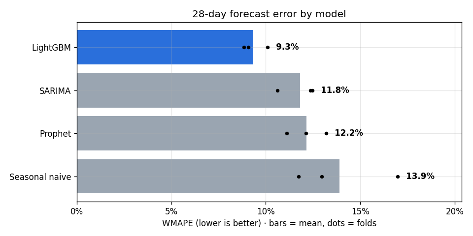
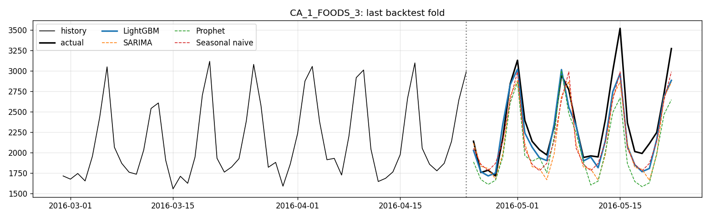
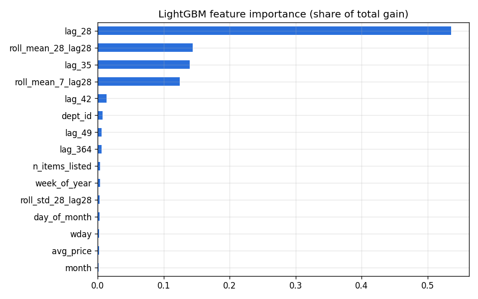

# Retail Demand Forecasting: SARIMA vs Prophet vs LightGBM

Forecasting 28 days of store × department demand on the Walmart **M5** dataset, with a **PySpark** feature
pipeline and a rolling-origin backtest of four models.

[](https://colab.research.google.com/github/jaishvin/m5-demand-forecasting/blob/main/notebooks/m5_demand_forecasting.ipynb)

## Business problem
Demand planners need reliable short-term forecasts to set replenishment and inventory levels. Classic
statistical models (ARIMA/SARIMA) handle seasonality well but struggle with promotions, price changes and
events. This project measures how much accuracy ML methods add on real retail data, and which drivers matter.

## Approach
| Step | What | Tools |
|---|---|---|
| 1. Ingest | Reshape 1,941 days of wide SKU-level sales to long format; join calendar and weekly prices | PySpark |
| 2. Features | Discount depth vs 8-week reference price, price index, SNAP days, events, lags (28–364 days), rolling means/std | PySpark window functions |
| 3. Models | Seasonal naive (baseline), SARIMA(1,0,1)(1,1,1,7), Prophet with events + price regressors, global LightGBM (Tweedie loss) | statsmodels, Prophet, LightGBM |
| 4. Backtest | Rolling-origin CV: 3 folds × 28-day horizon | pandas |
| 5. Evaluate | WMAPE, forecast accuracy (1 − WMAPE), bias; by department and event vs normal days | pandas, matplotlib |
| 6. Forecast | Retrain best model on all history and forecast the next 28 days | — |

All lag features are ≥ 28 days, so one LightGBM model forecasts the full 28-day horizon directly, with no
recursive forecasting and no leakage.

## Results
Backtest: 3 stores (CA_1, TX_1, WI_1) × 7 departments = 21 series, 3 rolling folds × 28-day horizon.

| Model | WMAPE | Forecast accuracy | Error reduction vs baseline | Bias | Fit time |
|---|---|---|---|---|---|
| **LightGBM** | **9.3%** | **90.7%** | **32.8%** | −1.3% | 10 s |
| SARIMA | 11.8% | 88.2% | 14.9% | −7.1% | 85 s |
| Prophet | 12.2% | 87.8% | 12.6% | −4.5% | 59 s |
| Seasonal naive | 13.9% | 86.1% | — | −4.0% | — |





**Key findings**
- **LightGBM is the most accurate:** 9.3% WMAPE, 21% lower error than SARIMA, and about 8× faster to fit, because one global model learns shared weekday, price and event patterns across all series.
- **LightGBM is also the least biased (−1.3%).** SARIMA under-forecasts by 7.1%, which in practice means more stock-outs.
- **Prophet trailed SARIMA** even with event and price regressors. Its smooth trend and seasonality curves miss the short-term swings that lag features capture.
- **Top demand drivers:** _fill in from feature_importance.png, e.g. recent rolling mean, lag_28, weekday._

## Run it
1. Click **Open in Colab** above.
2. Add `KAGGLE_USERNAME` and `KAGGLE_KEY` as Colab secrets and accept the
   [M5 competition rules](https://www.kaggle.com/competitions/m5-forecasting-accuracy/rules).
3. Runtime → Run all (about 10–15 minutes for 3 stores).

Set `DEMO_MODE = True` to test the pipeline on synthetic data without Kaggle.

## Repo structure
```
notebooks/m5_demand_forecasting.ipynb   main notebook (Colab-ready)
notebooks/m5_demand_forecasting.py      same notebook as a plain script (easier to review diffs)
results/                                metrics CSVs, charts and the 28-day forecast
requirements.txt
```

## Next steps
- Item-level forecasts with hierarchical reconciliation (store → state → total)
- Prediction intervals with LightGBM quantile loss, for safety-stock planning
- Scheduled weekly refresh (GitHub Actions) writing forecasts to a dashboard

## Data
[M5 Forecasting – Accuracy](https://www.kaggle.com/competitions/m5-forecasting-accuracy), Walmart via Kaggle.
Data is not included in this repo.
